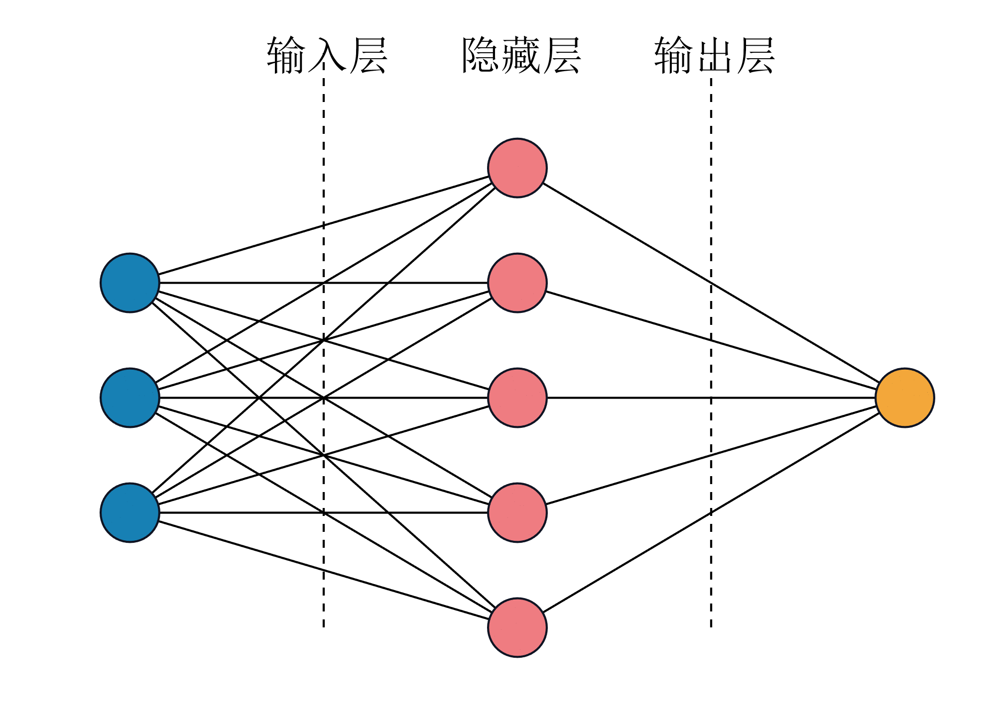

# MATLAB | Neural Network Prediction Diagram | Customize Input, Hidden, and Output Layers | Include data and plotting code | Directly Useable

1. Basic Definition
In SCI papers, neural network diagrams often appear. So, how is this diagram drawn in MATLAB? The code provided here is designed with an input layer of 3, an output layer of 5, and an intermediate hidden layer of 1 for the purpose of code writing and demonstration. You can certainly customize the number of layers for the input, hidden, and output layers to adjust the code accordingly and generate the desired diagram.
2. Diagram Generation
The diagram generation effect is as follows:
\n        \n
Video tutorial operation:
\n        \n          \n          \n          \n          \n            To view this video, please enable JavaScript, and consider upgrading to a web browser that supports HTML5 video.

## Images

<!-- PAYMENT_BLOCK -->

## Get this dataset

- Payment link (Stripe): [Buy now](https://buy.stripe.com/3cs8yP7sY87d0vu9AB)
- Payment QR code: 

<!-- /PAYMENT_BLOCK -->
